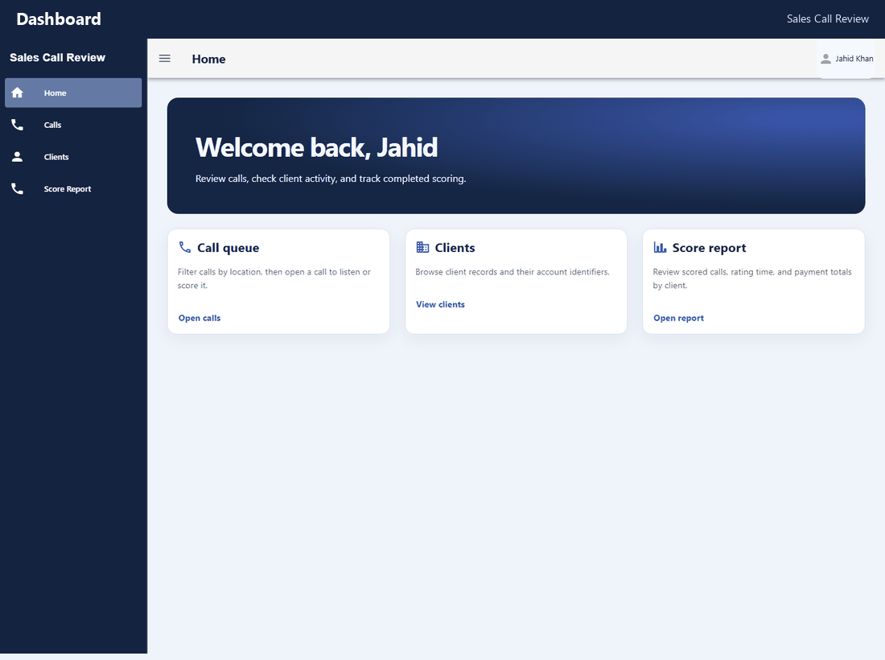

# sales-call-review

A workspace for sales managers and call reviewers to listen to recordings, score call outcomes consistently, and track review activity by client.

## Showcase overview



Follow the call queue into a pending review, compare it with a saved outcome, then see how reviewed calls roll up by client. [Browse the full-resolution screenshots](docs/media/screenshots), including all 28 seeded call detail pages.

## Key features

- Find calls by client, location, campaign, language, or date range.
- Listen to a call while recording its outcome, procedure, lead details, and review notes.
- Reopen reviewed calls to see the saved outcome and supporting details.
- View scored activity by client in the Score Report and export a CSV in showcase mode.
- Open a standalone player with seeking, skip controls, playback speed, and mute.

## Tech stack

| Area | Technologies |
| --- | --- |
| Frontend | Nuxt 2, Vue 2, TypeScript, Vuetify, Vuex |
| Requests and audio | Axios, WaveSurfer on call review pages, HTML audio in the standalone player |
| Connected backend | External API with Nuxt Auth and Laravel Sanctum |
| Build and testing | Yarn Classic, Webpack 4, Nuxt static generation, Jest |

## Architecture overview

Nuxt pages and Vuetify components use Vuex and shared Axios requests for the queue, call details, scores, and reports. In showcase mode, the [showcase plugin](plugins/showcase.ts) supplies a synthetic session and attaches the [local Axios adapter](showcase/api.ts), which reads and updates [seeded records](showcase/fixtures.ts). In connected mode, Nuxt Auth uses the configured external API for authentication and persistence.

## Engineering decisions

- **Share the Vuex and Axios path across modes.** The review UI consumes the same response shapes in both modes. The adapter provides local filtering, pagination, and score writes without a separate demo implementation of the forms.
- **Pre-generate seeded call URLs.** The [Nuxt config](nuxt.config.js) includes all 28 call detail routes in a static showcase build so readers can open pending and reviewed examples directly.
- **Use the same rows for the report chart and table.** The Score Report derives its chart and table from the same filtered response, so applying a date range updates both views together.

## Getting started

Use Node.js 22 and Yarn Classic. From the repository root in PowerShell:

```powershell
yarn install --frozen-lockfile --ignore-scripts
$env:SHOWCASE_MODE = 'true'
$env:NODE_OPTIONS = '--openssl-legacy-provider'
yarn dev
```

Open `http://localhost:3000`. Showcase mode is enabled by default and starts with a synthetic Super Admin named **Jahid Khan**. In Bash, use `SHOWCASE_MODE=true NODE_OPTIONS=--openssl-legacy-provider yarn dev`.

The install command keeps the Yarn lockfile and skips the legacy `vue-jest` dependency’s native `deasync` build, which can fail on Windows with `spawn EINVAL`. The OpenSSL option supports this repository’s Webpack 4 build.

To build the static showcase, run `yarn generate-prod` with the same environment settings and serve `dist/`.

### Connect the original backend

[.env.example](.env.example) lists the available environment variables. Set `SHOWCASE_MODE=false` and provide a compatible API base URL before starting or rebuilding. For development in PowerShell:

```powershell
$env:SHOWCASE_MODE = 'false'
$env:BASE_URL_DEVELOPMENT = 'http://localhost:8000/api/v1'
$env:NODE_OPTIONS = '--openssl-legacy-provider'
yarn dev
```

This enables the existing Nuxt Auth Laravel Sanctum strategy. Use `BASE_URL_STAGING` or `BASE_URL_PRODUCTION` for the corresponding package scripts. Set `SHOWCASE_MODE=true` or remove the override and restart or rebuild to return to the showcase.

## Walk through the app

1. Open `/calls?location=1` to see the Northstar Downtown queue.
2. Open `/call/2048` to listen to a pending call and inspect the scoring form. Open `/call/2047` to compare a saved review.
3. Open `/reports/score-report` to see recent sample activity. Change the date range or download the local CSV.

<details>
<summary>Route reference</summary>

| Area | Routes |
| --- | --- |
| Home and queue | `/`, `/calls` |
| Call details | `/call/2021` through `/call/2048` |
| Clients and profile | `/clients`, `/profile` |
| Report and standalone audio | `/reports/score-report`, `/player`, `/player?lead_id=2048` |
| Account forms | `/login`, `/forgot-password`, `/reset-password` |
| Missing call | `/call/9999` shows the app’s call-not-found view after Nuxt loads. A direct visit on a static host requires the host to serve the app fallback for that URL. |

</details>

## Quality baseline

```bash
yarn test --runInBand --coverage=false
```

The Jest suite tests the real showcase adapter. The three cases pass locally and cover location filtering and pagination, saving a score and resetting it in a fresh adapter, and a local 404. The coverage flag keeps this run focused on the adapter and avoids collecting Vue component coverage through the legacy transformer. The [Quality checks workflow](.github/workflows/quality.yml) runs this Jest suite on pushes and pull requests. The repository currently has no configured lint command.

### Pre-push hook

After installing dependencies, enable the hook once per clone:

```bash
git config --local core.hooksPath .githooks
```

The hook runs the same Jest suite before each push and blocks the push if Jest fails.

## Known limitations

- Showcase authentication and password recovery are simulated. Recovery sends no email.
- Audio is a bundled synthetic tone, and report times and rates are demo values.
- The queue adapter supports client, location, campaign, language, and date-range filters. It also recognizes `rated` and `unrated` API flags. It ignores the UI’s `rated_type`, caller number, call reference, and blacklisted-call filters. Blacklisted rows are always excluded from the showcase queue.
- Scores, profile edits, and theme changes live in the current app instance. A refresh or full-page navigation starts a fresh instance. Opening a call from the queue uses a full-page navigation.
- Connected mode requires a compatible external API.

## License

This project is licensed under the [MIT License](LICENSE).

## Author

**Jahid Khan Tuhin** · Full-stack JavaScript engineer

[LinkedIn](https://www.linkedin.com/in/jahidkhantuhin/)
